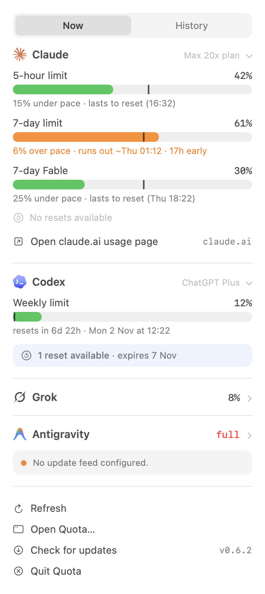
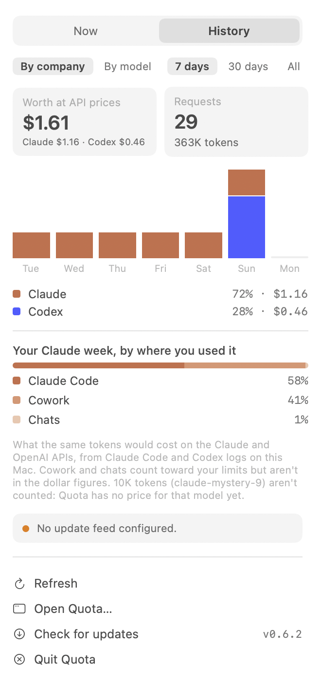
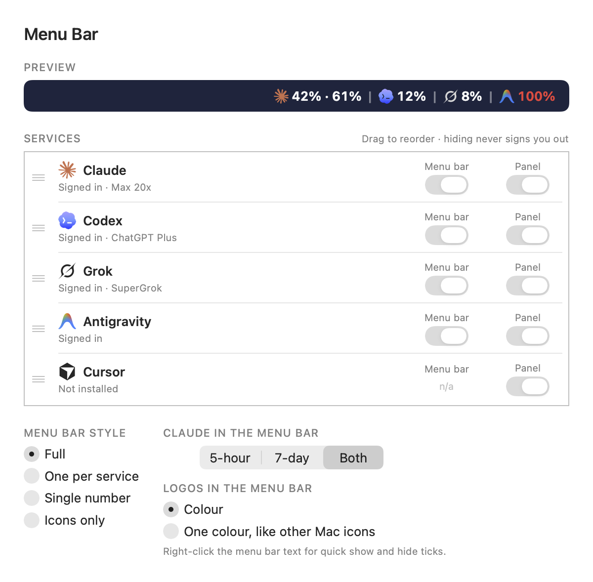
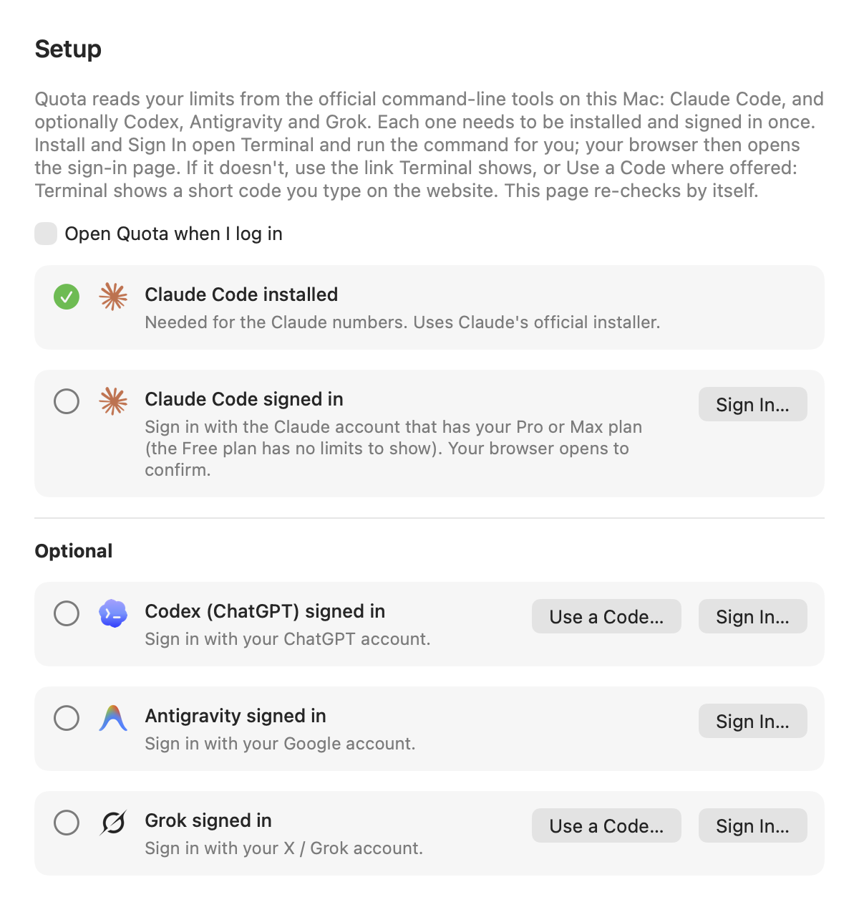

# Quota

A small Mac menu bar app that shows how much of your AI subscriptions you've used,
right next to the clock.


<p>


</p>

- **Claude** (Pro/Max): 5-hour, 7-day and model weekly limits, with a pace marker
  that tells you if you'll run out early ("27% ahead · runs out ~Mon · 2 days early").
- **Codex** (ChatGPT Plus/Pro): your Codex limits and any free resets.
- **Antigravity** (Google): its two weekly allowances, one shared by the Gemini models and one by
  the Claude and GPT models you use inside Antigravity (separate from your Claude and ChatGPT plans).
- **Grok** (SuperGrok): your weekly credit usage, read from the Grok CLI.
- **History**: what you used over 7 days, 30 days or all time, by company or by model, in each
  company's own colours, and what the same usage would have cost on the Claude and OpenAI APIs.
- **Your menu bar, your way**: choose which services show in the menu bar and in the panel,
  drag them into your order, and pick a style (full, one number per service, a single number,
  or logos only). Right-click the menu bar text for a quick menu.

<p>

</p>

This repository only hosts the downloads.

## Before you install

- A Mac with macOS 13 or later.
- A Claude **Pro or Max** plan (the Free plan has no usage limits for Quota to show).
- **Claude Code**. The Claude desktop app's built-in Claude Code counts. If you don't have it,
  Quota's Setup page installs it for you.
- Optional: the **Codex** CLI or the **ChatGPT** desktop app, Google's **Antigravity** CLI (`agy`)
  and the **Grok** CLI, for those sections.

## Install (one time)

**Easiest: paste this into Terminal** (Applications → Utilities → Terminal):

```
curl -fsSL https://raw.githubusercontent.com/DavidMolina001/quota-app/main/install.sh | sh
```

It downloads the latest version, checks it is signed by Quota, puts Quota in Applications
(or your own Applications folder if your Mac account isn't an admin) and opens it.
No "could not verify" warning appears this way.

**Or by hand:**

1. Download `Quota-x.y.z.zip` from [Releases](https://github.com/DavidMolina001/quota-app/releases/latest) and open it.
2. Drag **Quota** into **Applications** and open it.
3. Because it came through your browser, macOS will say it "could not verify" Quota. Open
   **System Settings → Privacy & Security**, scroll down, click **Open Anyway**.
   You only do this once.

Then click Quota in the menu bar and turn on **Launch at login**. Quota opens its Setup page the first time.

## Sign in with your own accounts

Open Quota → **Setup**. Each service has a **Sign In** button: it opens Terminal, runs that
service's own sign-in command, and your browser opens the service's sign-in page. Sign in there
with your own account and Setup ticks itself off.

If the browser doesn't open, Terminal shows the link to open yourself. Codex and Grok also offer
**Use a Code**: Terminal shows a short code that you type on the service's website.
Antigravity asks you in Terminal to pick Google OAuth (your Google account) or a Google Cloud project.



Quota never sees your password: you sign in on each company's own website, and their own tools
keep the sign-in.

## Updates

Nothing to do. Quota checks for new versions every hour, downloads them and
installs them quietly while its panel is closed. Every update is checked against its
checksum and must be signed with the same certificate as the copy you have, or it's
thrown away.

## Privacy

- Quota gets its numbers by asking Claude Code, Codex, Antigravity and Grok, already on your Mac and
  signed in as you, for their own usage reports.
- History comes from the logs those tools already keep on your Mac. Only token counts,
  model names and dates are read, never your conversations.
- Quota never reads your passwords, login tokens or cookies, never sends your usage
  anywhere, and needs no special macOS permissions. Its only network request is the
  update check.

## Uninstall

Click Quota → Quit Quota, then drag it from Applications to the Bin. Its usage log stays in
`~/Library/Application Support/Quota`; drag that folder to the Bin too if you want it gone.
If you turned on Launch at login, turn it off first (or remove Quota under System Settings → General → Login Items).
